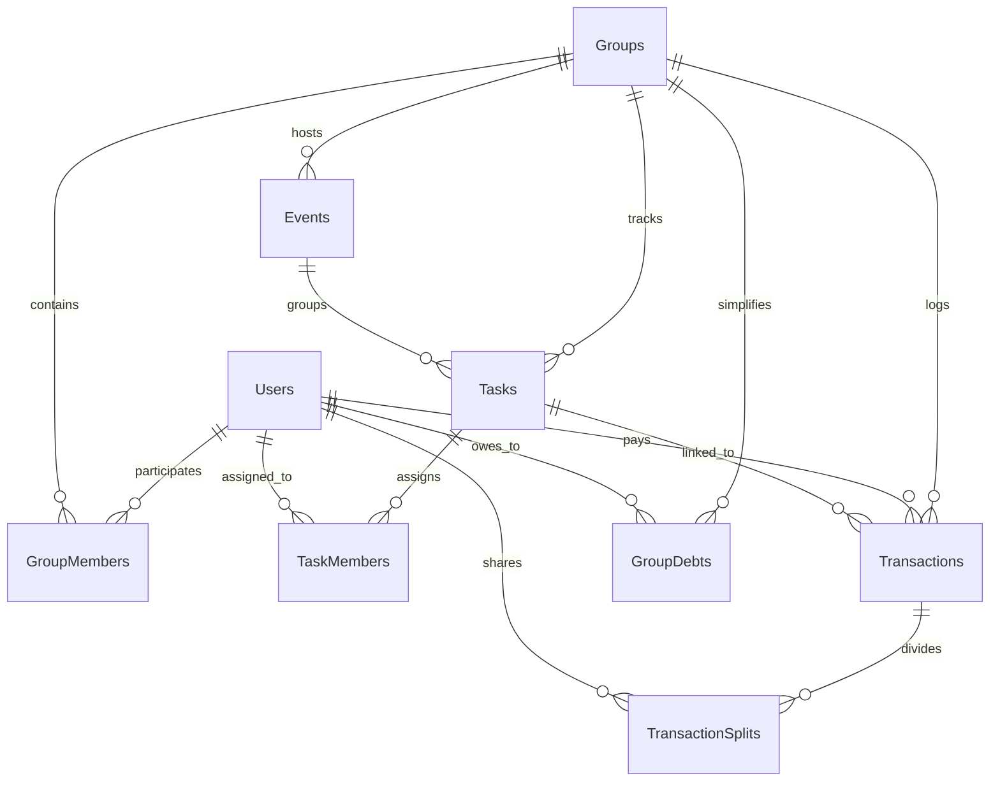

# WeShare — Smart Bill Splitting & Group Task Management


---

## 1. Tổng Quan Dự Án (Overview)

**WeShare** là nền tảng quản lý tài chính nhóm, chia sẻ hóa đơn (bill-splitting) và điều phối công việc/sự kiện toàn diện (*All-in-one Group Hub*), được thiết kế tối ưu cho các câu lạc bộ sinh viên, nhóm bạn bè, đội ngũ dự án và nhóm du lịch.

Khác với các ứng dụng chia tiền đơn thuần, **WeShare** liên kết chặt chẽ giữa **Nhiệm vụ (Tasks/Events)** và **Tài chính (Expenses/Debts)**:
- Tự động quy đổi và liên kết chi phí phát sinh vào từng đầu việc cụ thể.
- Tính toán và bù trừ công nợ chéo thông minh (giảm thiểu số lần chuyển khoản giữa các thành viên).
- Tích hợp thanh toán tức thì một chạm qua chuẩn mã **VietQR Napas247**.
- Quản lý công việc trực quan bằng **Kanban Board** và lịch trình sự kiện dạng **Timeline**.

---

## 2. Tính Năng Cốt Lõi (Key Features)

### 2.1. Quản lý Chi tiêu & Phân chia Hóa đơn (Expense Splitter)
- **3 Chế độ chia tiền linh hoạt:**
  - `EQUALLY`: Chia đều tự động cho những thành viên được chọn.
  - `PERCENTAGE`: Chia theo tỷ lệ phần trăm (tự động kiểm tra ràng buộc 100%).
  - `EXACTLY`: Phân bổ số tiền chính xác theo từng món hoặc từng người.
- **Liên kết Chi tiêu vào Công việc (Task-to-Bill):** Đính kèm công việc phụ trách (ví dụ: *"Mua thực phẩm"*) vào hóa đơn để minh bạch lý do chi tiêu.
- **Đính kèm Biên lai:** Tải ảnh hóa đơn / ủy nhiệm chi ngân hàng (`Receipt upload`) làm bằng chứng giao dịch.

### 2.2. Bù trừ Công nợ & Quyết toán Nhanh (Debt Simplification & Settle Up)
- **Mô hình Hybrid Debt Engine:** Tự động tính toán số dư ròng (*Net Balance*) và sổ cái công nợ trực tiếp (*Who Owes Whom*), triệt tiêu các khoản nợ vòng tròn.
- **Thanh toán VietQR Napas247:** Tự động sinh mã QR ngân hàng chuẩn kèm tên chủ tài khoản, số tài khoản, số tiền chính xác và nội dung chuyển khoản.
- **Thanh toán Tiền mặt:** Ghi nhận và đối soát nhanh các khoản thanh toán trực tiếp ngoài đời thực.

### 2.3. Điều phối Công việc & Sự kiện (Task & Event Hub)
- **Kanban Board 3 cột:** Quản lý quy trình nhiệm vụ mượt mà (*To Do*, *In Progress*, *Completed*).
- **Phân công Đa thành viên (Multi-assignee):** Giao việc cho nhiều người cùng lúc với avatar trực quan.
- **Nhận diện Deadline Thông minh:** Tự động gắn tag cảnh báo *Quá hạn (Overdue)* hoặc *Sắp tới hạn (Due Soon trong 24h)*.
- **Event Timeline:** Khối thời gian sự kiện, danh sách người tham dự và thanh tiến độ hoàn thành công việc.

### 2.4. Trải nghiệm Người dùng (Wise Design System)
- Ngôn ngữ thiết kế hiện đại lấy cảm hứng từ Wise: tông màu chủ đạo **Forest Ink** (`#163300`) kết hợp **Lime Voltage** (`#9fe870`), hệ thống bo góc viên thuốc (`rounded-full`), thẻ bo góc mềm mại 24px–28px.
- Hỗ trợ toàn diện **Dark Mode / Light Mode**.
- Responsive đa nền tảng: Desktop Sidebar có thể thu gọn, Mobile Bottom Navigation cố định với nút Quick Add tiện lợi.

---

## 3. Kiến Trúc & Công Nghệ (Tech Stack)

Dự án được cấu trúc theo mô hình **Monorepo**:

```text
WeShare/
├── BackEnd/                # .NET 8 Web API (Clean Architecture)
└── FrontEnd/               # React 18 + Vite + TypeScript (SPA)
```

### 3.1. Phía Backend (.NET 8 Clean Architecture)
- **Cấu trúc Layers:**
  - `WeShare.API`: Controllers (`[Route("api/[controller]")]`), Middlewares xử lý ngoại lệ tập trung (`GlobalExceptionMiddleware`), JWT Authentication, Swagger OpenAPI.
  - `WeShare.Application`: Interfaces dịch vụ, Services nghiệp vụ, DTOs, AutoMapper Profiles, Fluent Validation.
  - `WeShare.Core`: Entities kế thừa `BaseAuditableEntity`, Enums, Constants, Domain Exceptions, Repository Interfaces.
  - `WeShare.Infrastructure`: `WeShareDbContext` (EF Core), Migrations, Generic Repositories, UnitOfWork, PostgreSQL Database Extensions.
- **Cơ sở dữ liệu:** PostgreSQL với mô hình khóa ngoại, ràng buộc kiểm tra toàn vẹn và concurrency token (`Version Guid`).
- **Xác thực:** JWT Bearer Token với Claims-based Authorization.
- **Kiểm soát đồng thời (Concurrency):** Optimistic Concurrency Control qua `If-Match` ETag headers.

### 3.2. Phía Frontend (Modern React Ecosystem)
- **Core:** React 18, TypeScript (Strict Mode), Vite 7.
- **UI Framework & Styling:** Tailwind CSS v4, Shadcn UI (`@/components/ui/`), Lucide React Icons.
- **State Management & Data Fetching:**
  - Redux Toolkit (`src/store/`): Quản lý Authentication state và User profile.
  - TanStack React Query: Cache dữ liệu server, tự động invalidate queries khi thay đổi, hỗ trợ optimistic updates.
- **HTTP Client:** Axios Client (`src/axios/axiosInstance.ts`) tích hợp interceptor gắn Auth Bearer token và refresh token queue.
- **Form Management & Validation:** React Hook Form + Zod Schema Resolver.

---

## 4. Kiến Trúc Cơ Sở Dữ Liệu (Database Architecture)

Cơ sở dữ liệu sử dụng mô hình **Hybrid Debt Architecture**, phân tách giữa lịch sử giao dịch bất biến (`Transactions`, `TransactionSplits`) và sổ nợ ròng thời gian thực (`GroupDebts`), kết hợp cơ chế kiểm soát phiên bản `Version` và xóa mềm (`IsDeleted`).

### 4.1. Chi tiết các Bảng dữ liệu (Table Schemas)

#### `Users`
| Cột | Kiểu | Ràng buộc | Mô tả |
|-----|------|-----------|-------|
| `Id` | INTEGER | PK, Identity | Mã định danh người dùng |
| `FullName` | VARCHAR(255) | NOT NULL | Họ và tên |
| `Email` | VARCHAR(255) | NOT NULL, UNIQUE | Địa chỉ email đăng nhập |
| `Avatar` | VARCHAR(500) | NULL | URL ảnh đại diện |
| `DefaultBankAccount` | VARCHAR(100) | NULL | Số tài khoản ngân hàng mặc định |
| `BankName` | VARCHAR(100) | NULL | Tên ngân hàng thụ hưởng |
| `BankBin` | VARCHAR(50) | NULL | Mã định danh ngân hàng (BIN Napas) |
| `PasswordHashed` | TEXT | NOT NULL | Mật khẩu băm an toàn |

#### `Groups`
| Cột | Kiểu | Ràng buộc | Mô tả |
|-----|------|-----------|-------|
| `Id` | INTEGER | PK, Identity | Mã định danh nhóm |
| `Name` | VARCHAR(200) | NOT NULL | Tên nhóm |
| `Type` | INTEGER | NOT NULL | 1: Club, 2: Travel, 0: General |
| `IsDeleted` | BOOLEAN | DEFAULT FALSE | Trạng thái xóa mềm |

#### `GroupMembers`
| Cột | Kiểu | Ràng buộc | Mô tả |
|-----|------|-----------|-------|
| `UserId` | INTEGER | PK, FK -> Users | Mã thành viên |
| `GroupId` | INTEGER | PK, FK -> Groups | Mã nhóm |
| `Role` | INTEGER | NOT NULL | 1: Leader (Trưởng nhóm), 2: Member |
| `Balance` | DECIMAL(18,2)| DEFAULT 0 | Số dư tổng thể của thành viên trong nhóm |

#### `Events`
| Cột | Kiểu | Ràng buộc | Mô tả |
|-----|------|-----------|-------|
| `Id` | INTEGER | PK, Identity | Mã sự kiện |
| `GroupId` | INTEGER | FK -> Groups | Nhóm tổ chức |
| `CreatedById` | INTEGER | FK -> Users | Người tạo sự kiện |
| `Name` | VARCHAR(200) | NOT NULL | Tên sự kiện |
| `Description` | VARCHAR(5000)| NULL | Mô tả chi tiết |
| `Location` | VARCHAR(500) | NULL | Địa điểm tổ chức |
| `EventDate` | TIMESTAMP | NULL | Thời gian bắt đầu (UTC) |
| `EndsAt` | TIMESTAMP | NULL | Thời gian kết thúc (UTC) |
| `Version` | UUID | NOT NULL | Concurrency token chống ghi đè dữ liệu |

#### `Tasks` & `TaskMembers`
| Bảng | Cột chính | Mô tả |
|------|-----------|-------|
| **`Tasks`** | `Id`, `GroupId`, `EventId`, `Title`, `Description`, `Status`, `DueAt`, `Version` | Công việc với trạng thái (0: Created, 1: InProgress, 2: Done, 3: Canceled) |
| **`TaskMembers`** | `TaskId`, `UserId`, `GroupId`, `Status` | Quan hệ nhiều-nhiều người chịu trách nhiệm công việc |

#### `Transactions` & `TransactionSplits`
| Bảng | Cột chính | Mô tả |
|------|-----------|-------|
| **`Transactions`** | `Id`, `GroupId`, `PayerId`, `Amount`, `Description`, `TaskId`, `SplitStrategy`, `Type`, `ProofUrl`, `Status` | Khoản chi (EXPENSE) hoặc quyết toán (PAYMENT), liên kết với Task tùy chọn |
| **`TransactionSplits`** | `TransactionId`, `DebtorId`, `OwedAmount` | Chi tiết số tiền từng người phải trả trong khoản chi |

#### `GroupDebts`
| Cột | Kiểu | Ràng buộc | Mô tả |
|-----|------|-----------|-------|
| `Id` | INTEGER | PK, Identity | Mã dòng nợ |
| `GroupId` | INTEGER | FK -> Groups | Mã nhóm |
| `FromUserId` | INTEGER | FK -> Users | Con nợ (người cần trả tiền) |
| `ToUserId` | INTEGER | FK -> Users | Chủ nợ (người được nhận tiền) |
| `Amount` | DECIMAL(18,2)| NOT NULL | Số tiền còn nợ hiện tại |

### 4.2. Sơ đồ Quan hệ Thực thể (ERD Diagram)



---

## 5. Hướng Dẫn Cài Đặt & Chạy Dự Án (Getting Started)

### 5.1. Yêu cầu Môi trường (Prerequisites)
- **.NET SDK:** 8.0 trở lên (`dotnet --version`)
- **Node.js:** v18 hoặc v20+ (`node -v`)
- **Cơ sở dữ liệu:** PostgreSQL 14+ đang chạy local hoặc Docker.

### 5.2. Khởi chạy Backend (.NET 8)
1. Di chuyển vào thư mục Backend:
   ```bash
   cd BackEnd
   ```
2. Cấu hình chuỗi kết nối trong `WeShare.API/appsettings.json`:
   ```json
   "ConnectionStrings": {
     "DefaultConnection": "Host=localhost;Port=5432;Database=weshare_db;Username=postgres;Password=your_password"
   }
   ```
3. Cập nhật Database Migration:
   ```bash
   dotnet ef database update --project WeShare.Infrastructure --startup-project WeShare.API
   ```
4. Kiểm tra biên dịch và khởi chạy server:
   ```bash
   dotnet build WeShare.sln
   dotnet run --project WeShare.API
   ```
   *API Swagger UI mặc định sẵn sàng tại:* `https://localhost:7133/swagger`

### 5.3. Khởi chạy Frontend (React + Vite)
1. Di chuyển vào thư mục Frontend:
   ```bash
   cd FrontEnd
   ```
2. Cài đặt các gói phụ thuộc:
   ```bash
   npm install
   ```
3. Cấu hình file môi trường `.env`:
   ```env
   VITE_API_URL=https://localhost:7133/api
   ```
4. Chạy môi trường phát triển (Development):
   ```bash
   npm run dev
   ```
   *Giao diện người dùng mở tại:* `http://localhost:5173`
5. Kiểm tra build sản phẩm (Production build & TypeScript check):
   ```bash
   npm run build
   ```

---

## 6. Quy Chuẩn Đóng Góp Mã Nguồn (Development Conventions)

- **API Contract:** Mọi phản hồi từ Backend đều trả về theo định dạng chuẩn:
  ```json
  {
    "status": 200,
    "message": "Thao tác thành công",
    "data": { ... }
  }
  ```
- **Git Workflow:**
  - Không commit trực tiếp lên nhánh `main`.
  - Tạo nhánh tính năng riêng biệt: `git checkout -b feat/<ten-tinh-nang>`.
  - Kiểm tra trạng thái biên dịch (`dotnet build` và `npm run build`) trước khi tạo Pull Request.
- **UI Guidelines:** Mọi thành phần UI phải tuân thủ hướng dẫn thiết kế tại [`FrontEnd/DESIGN.md`](file:///d:/WeShare/WeShare/FrontEnd/DESIGN.md).

---

## 7. Giấy Phép (License)

Dự án được phân phối dưới giấy phép **MIT License**. Mọi quyền được bảo lưu bởi đội ngũ phát triển WeShare.
